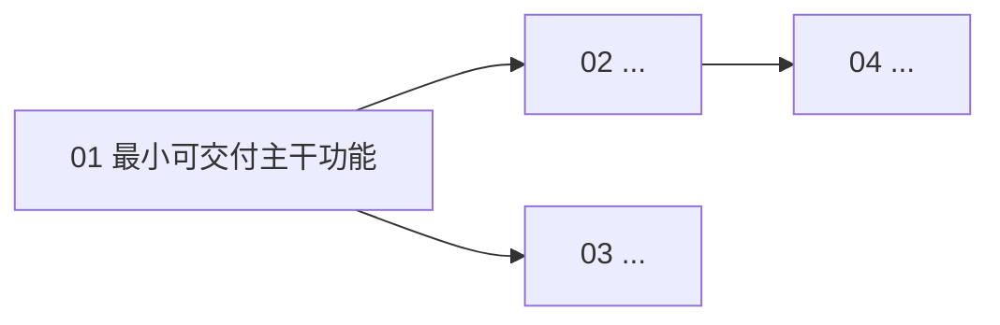

# Epic 立项参考：业务体检清单、切片规则与文档模板

仅在**模式 A（立项拆 Story）**加载。所有体检、提问与产出的文档均使用**产品与用户能直接理解的业务语言**，不讨论也不写入底层技术实现细节。

---

## 一、现成 PRD 业务体检清单（快车道专用）

用户提供较完整的现成 PRD 时，通读全文并聚焦以下 4 点做轻量体检——只把真正影响**产品行为**或**Story 切片**的缺口带入定向 `grilling`：

1. **现网产品口径核实（轻量核实，不挖底层实现）**：
   - PRD 提到的页面入口/Tab 位置、字数/数量上限、已有功能能力是否与当前产品现状一致？
   - PRD 中的新概念是否与仓库既有业务术语 `GLOSSARY.md` 冲突？
2. **业务规则与状态闭环**：
   - 前后业务规则有无矛盾（如前文允许重复、后文禁止重复）？
   - 核心业务状态是否完整闭环（创建、生效、变更、失败、撤销等）？
3. **可见边界与异常处理**：
   - 失败时用户看到什么提示？空态、超限、无权限、外部平台不支持时的业务兜底行为是否明确？
4. **交付范围与切片边界**：
   - 目标 / 非目标是否清晰？哪些能力属于首期必做（MVP），哪些可以拆到后续 Story（Post-MVP）？
   - 最小可交付主干功能（Story `01`）的边界是否清晰？

输出简明体检摘要（按「现网口径差异 / 业务规则与边界缺口 / 切片与 MVP 范围待确认」三类列出），**不输出底层代码类名、表结构、锁机制或 SDK 实现细节**。

---

## 二、垂直切片规则（SPIDR + 主干优先）

拆出 `story-map.md` 时遵循以下规则：

- **按用户可感知价值纵向切片**：每个 Story 交付一个完整、可演示、可独立验收的业务能力；不按技术层次（如"建表 / 后端接口 / 前端页面 / 协议对接"）横向拆分。
- **Story `01` 必须是最小可交付使用的主干功能（强约束）**：
  - 必须是真实可用、可独立上线/验收的最核心端到端主路径（剥离复杂规则、次要分支和高级配置，但用户能完整走通核心业务闭环并产生真实价值）；
  - 不是纯技术脚手架、空壳接口或仅能跑通联调的 stub；
  - `01` 默认无前置依赖（`Blocked by: None`），后续 Story 在此主干上增量叠加分支、规则、渠道或扩展场景。
- **SPIDR 拆法**（单个 Story 过大时优先按这五个产品维度切）：
  - **P（Paths）**：按用户路径拆（主路径先行，次要分支/异常补齐/特殊场景放后续 Story）；
  - **I（Interfaces）**：按使用入口或交互形态拆（先最小可用核心入口，后增强展示、筛选、统计或辅助面板）；
  - **D（Data）**：按业务对象/渠道范围拆（先跑通核心平台/单类型，后扩展多渠道/多类型/批量）；
  - **R（Rules）**：按业务规则复杂度拆（先最小必要规则跑通闭环，后叠加复杂条件组合、高级限制或策略）；
  - **S（Spike）**：仅当存在无法拍板的外部业务能力/交互未知点时，先用 `research` / `prototype` 验证再决定切片。
- **粒度标尺**：单个 Story 聚焦一个清晰的业务主题，产品/业务方一眼能看懂「做完后多了什么能力」；细化 `spec.md` 后通常对应 2–8 个开发 Ticket，过碎则合并，过胖则再切。

---

## 三、文档模板

### 1. `prd.md`

```markdown
# Epic: <Epic 名称>

- **Slug**: `YYYY-MM-<epic-slug>`
- **来源**: <原始 PRD 链接 / Issue 链接 / 对话立项>
- **状态**: `draft` | `approved` | `in-progress` | `done`
- **业务术语表**: `GLOSSARY.md`（如有）

## 背景与问题

从用户和业务视角说明当前痛点、触发原因与预期价值。

## 目标与成功指标

- **目标 1**: <可观察的业务结果>
- **成功指标**: <可量化口径>

## 非目标（Out of Scope）

明确本期刻意不做的范围，防止后续切片与细化蔓延。

## 角色与核心旅程

- **<角色 A>**: <端到端主旅程与关键体验节点>
- **<角色 B>**: <...>

## 全局业务规则与补充拍板口径

跨多个 Story 必须共同遵守的业务不变式（核心规则、权限与隔离、统一口径、快车道中本次新拍板的冲突裁决等）。单个 Story 独有的细节留待对应 `spec.md`。

## 业务风险与外部前提

- <外部平台权限/业务限制、存量用户兼容预期等业务侧前提>
```

---

### 2. `story-map.md`

```markdown
# Story Map: <Epic 名称>

- **PRD**: [prd.md](./prd.md)
- **Epic Issue**: <远端链接，纯本地模式写"本地模式（未同步）">

## MVP 界线

- **MVP 包含**: Story 01 – 0X（达成用户可用的最小业务闭环：<一句话描述>）
- **Post-MVP**: Story 0Y – 0Z（延后原因：<为何不影响核心主干上线>）

## 依赖图（DAG）



## Story 清单与状态

状态流转：`intent` → `spec-ready` → `in-progress` → `done`

| 编号 | Story | 阶段 | 依赖（Blocked by） | 状态 | Intent / Spec | Story Issue |
|---|---|---|---|---|---|---|
| 01 | <最小可交付主干功能名称> | MVP（主干） | None | `intent` | [intent](stories/01-<slug>/intent.md) | - |
| 02 | <Story 名称> | MVP | 01 | `intent` | [intent](stories/02-<slug>/intent.md) | - |
| 03 | <Story 名称> | Post-MVP | 01 | `intent` | [intent](stories/03-<slug>/intent.md) | - |
```

---

### 3. `stories/<NN>-<story-slug>/intent.md`

保持轻量（通常 30–50 行），全程使用产品和用户能直接读懂的语言，锁定**业务价值、范围与验收边界**，不写技术实现方案。

```markdown
# Story <NN>: <Story 名称>

- **Epic**: [<Epic 名称>](../../prd.md)
- **阶段**: `MVP（主干）` | `MVP` | `Post-MVP`
- **Blocked by**: `<NN>` / `None`
- **Story Issue**: <远端链接或"本地模式">

## 用户价值（Why & What）

2–4 句话说清本 Story 交付后，哪个角色能完成什么事、获得什么直接价值。

## 核心场景

- <核心使用场景 1>
- <核心使用场景 2>
- <关键异常或边界（产品视角一句话即可）>

## 验收边界（Done Definition）

用产品与用户可直接验证的外部行为描述「什么算做完」：
- [ ] <可验证的用户/业务行为 1>
- [ ] <可验证的用户/业务行为 2>

## 前置依赖与下游衔接

- **依赖前置能力**: <前置 Story 提供的业务能力，无则写"无">
- **为后续铺垫**: <后续 Story 将在此之上叠加什么能力，无则写"无">

## 本 Story 不做（Out of Scope）

明确划归其他 Story 或本期之外的内容，防止细化 `spec.md` 时范围膨胀。

## 细化前待确认点（供模式 B 参考）

记录立项时有意推迟到开工前再敲定的产品/体验细节；无则省略。
```
