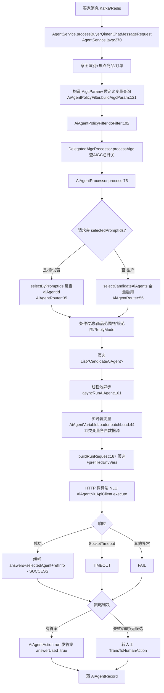
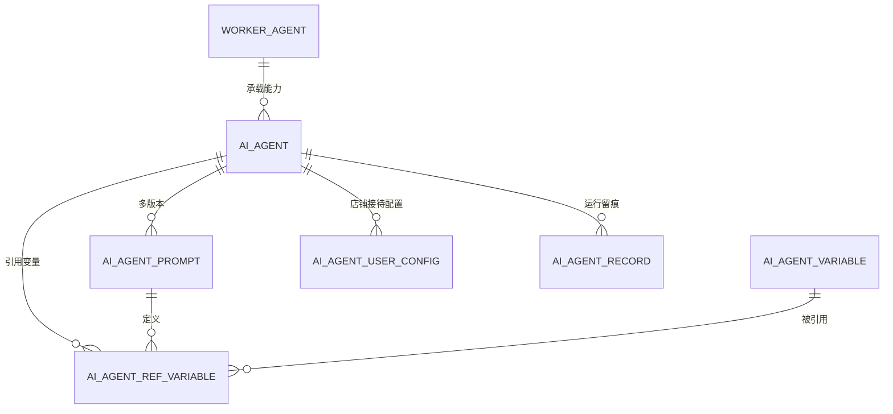
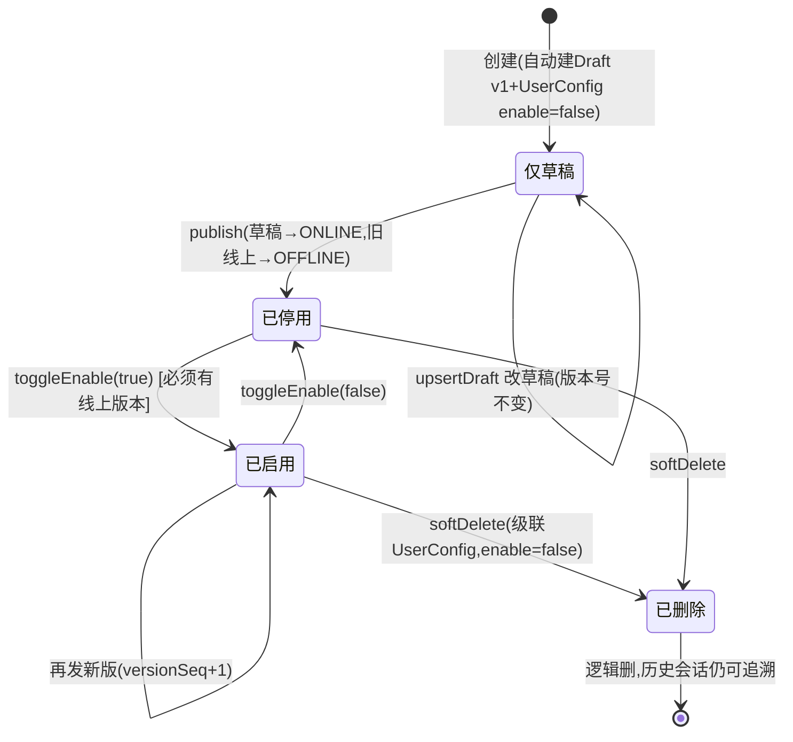

# 实跑范例：metis「自定义AIAgent」全景讲解

一次真实产出，照此对齐**深度**（到 file:line / 状态机 / 规则边界 / 外部契约 / 演进WHY / 盲区）与**结构**（12 段）。
项目：metis（电商 AI 客服，Java 多模块）。这业务横跨 entity/web/agent/core/valueobject 六模块，派了 4 个 facet 探子（数据模型 / 配置流 / 运行流 / WHY）。

---

## 1. 一句话定义 + 业务目标

**自定义 AIAgent**：让淘宝卖家自己用「触发场景 + 提示词」定义一个 AI 客服技能（Agent），发布后买家咨询命中场景时，大模型自动选中它生成回复——无需等产品后台排期配置。

产品目标（PRD/commit 推断）：系统 Agent 后台定义、迭代慢、知识易饱和 → 卖家自助绕过排期；对齐大模型 **SKILL 路由** 方向（卖家 Agent = 一个 skill，LLM 自选调用）；统一"多 Agent + 技能知识"割裂；市场刚需（User Req #1781）。

演进：系统 Agent 1.0（2025-12，票 9768~9791）→ 知识学习补强（2026-03，10105）→ 自定义 Agent（2026-05，**主票 10337 / commit `66284b41c2`**）。晚 3 个月，等系统 Agent 与 WorkerAgent 抽象成熟。

## 2. 术语表

| 中文 | 代码标识 | 含义 |
|---|---|---|
| 系统 Agent | `AiAgentSource.SYSTEM` | 后台/算法定义，全店开放 |
| 自定义 Agent | `AiAgentSource.CUSTOM` | 卖家定义，店铺私有 |
| 触发场景 | `positiveRouterPrompt` | 「什么时候用这个 Agent」，喂 LLM 做路由 |
| 禁答范围 | `negativeRouterPrompt` | 不应答的问题；自定义 Agent 不开放，写进提示词 |
| 提示词 | `promptTemplate` | Agent 应答规则 |
| Worker Agent | `WorkerAgent` | 算法侧真正执行体；AiAgent 引用，对卖家隐藏 |
| 固定/大模型路由 | `AiAgentRouteType.FIXED_ROUTE` / `LLM_ROUTE` | 自定义 Agent 固定 LLM_ROUTE |
| 接待配置 | `AiAgentUserConfig` | 某店对某 Agent 的启停/商品范围/客服范围/回复模式 |
| 版本序号 | `AiAgentPrompt.versionSeq` | Prompt 版本，发布递增 |
| 草稿/线上/下线 | `AiAgentPromptStatus.DRAFT/ONLINE/OFFLINE` | Prompt 生命周期 |

## 3. 角色 & 场景

角色：卖家主账号（owner，配额归属）/ 子账号（可改本店任意 Agent，留痕到主账号）/ 买家（触发方）/ 算法 NLU 服务（外部大模型）。

主场景：①配置态（metis-web）建→写草稿→发布→配范围→启用；②运行态（metis-agent）买家发问→拢候选→LLM 选中生成→回复/转人工。

## 4. 端到端运行时流程图

裁决：候选由 Router 过滤产出，**最终选哪个由算法侧 LLM 决定**，返回 `selectedAgent`。

## 5. 数据模型

| 实体 | 职责 | 关键字段 |
|---|---|---|
| AiAgent | Agent 核心 | `source` · `userId/subUserId` · `workerAgentId` · `routeType` · `onlinePromptId` · `visibleScope` · `deleted` |
| AiAgentPrompt | Prompt 版本+状态机 | `positiveRouterPrompt` · `negativeRouterPrompt` · `promptTemplate` · `versionSeq` · `promptStatus` · `publishBy/Time` |
| AiAgentVariable | 变量库 | `aiAgentVariable`(枚举码) · `category` · `useSnapInEval` |
| AiAgentRefVariable | Prompt↔变量关联 | `aiAgentPromptId` · `aiAgentVariableId` · `required` |
| AiAgentUserConfig | 店铺接待配置 | `userId` · `enable` · `itemRelatedType` · `replyMode` · `wangwangRelatedType` |
| WorkerAgent | 算法侧执行体 | `agentPlatform` · `agentType` · `platformAgentCode` |
| AiAgentRecord | 运行记录 | `candidateAiAgents` · `refAiAgentId/PromptId` · `aiAgentAnswers` · `requestStatus` · `answerUsed` · `chatDay`(分区) |

关键枚举：`AiAgentVariableEnum`(11 类注入变量：买家/历史对话/焦点商品/尺码表/焦点订单/物流/知识库/当前输入/店铺/最近订单/后填充) · `ItemRelatedType`(ALL/ITEM/ITEM_GROUP/SELLER_CAT) · `ReplyMode`(仅全自动/仅智能辅助/通用) · `WangwangRelatedType`(不限/客服/客服组)。

> 部分表名是 @Table 推断，落地前以实际注解为准。

## 6. 状态机

闸门：未发布不能启用（`AiAgentBo:230`，报「请先发布后再设置启用/停用状态」）。

## 7. 核心业务规则

| 规则 | 条件 | 位置 |
|---|---|---|
| 配额上限 20/店 | 创建时 | `AiAgentBo:63`，超限报「已达上限(n/20)」 |
| 自动建草稿+配置 | 创建时 | 默认 Worker + 全量变量(非必填) + UserConfig(enable=false) |
| 字段长度校验 | 创建/改 | 名称1-50 · 简介0-140 · 触发场景4-300 · 提示词4-1200(原1000→1200) · 禁答0-1000 |
| 归属/跨店隔离 | 所有改操作 | 仅 owner 店可改，跨店报「无权操作非本店 AIAgent」 |
| 草稿版本号 | upsert 新草稿 | nextSeq=online版本+1，改旧草稿不涨 |
| 乐观锁冲突 | 存草稿 | 报「草稿已被他人修改，请刷新后重试」 |
| 发布通知算法 | publish | 发 `SystemEventType.AI_AGENT_CHANGE` 事件让算法拉配置 |
| 软删除 | delete | 仅自定义可删，级联 UserConfig，保历史 |
| 日志仅记发布过的 | 各操作 | 改名/删除仅 `hadOnline=true` 才记 |

审计日志（`CustomAiAgentAuditLogger`，logType=`AI_AGENT_USER_CONFIG`）：`新建/发布/修改/启用/停用/删除 自定义 AIAgent：<名>`。

## 8. 触发入口

配置态（`CustomAiAgentController` `/api/custom-ai-agent/*`）：detail · create · update-basic · update-config · toggle-enable · upsert-draft · publish · soft-delete · quota · list · simulation-list。
接待配置（`AiAgentUserConfigController` `/api/ai-agent-user-config/*`）：update · list · enable · in-ai-agent-white。
运行态：`AgentService.processBuyerQimenChatMessageRequest:270`（Kafka 消费买家消息）。

## 9. 关键代码路径（运行时）

`AgentService:270` → `processNluResultAndPublish:567` → `Policy.process:58` → `AiAgentPolicyFilter.doFilter:102` → `DelegatedAigcProcessor.processAigc:29` → `AiAgentProcessor.process:75` → `AiAgentRouter.select*` → `AiAgentVariableLoader.batchLoad:44` → `AiAgentProcessor.buildRunRequest:167` → `AiAgentNluApiClient.execute`。

## 10. 依赖 & 外部交互

- 算法 NLU 服务（外部）：`AiAgentNluApiClient` HTTP；契约带 `candidateAgents`+`prefilledEnvVars`，回 `selectedAgent`+`answers`。发布经事件通知算法拉配置。
- 变量数据源：StdItemService(商品)/TradeService(订单)/物流/知识库/SessionChatMessage(历史)/ItemSizeTable(尺码)/UserInfo(店铺)。
- VariableLoader 插件机制：实现 `VariableLoader`+`@Component` 自动注册进 map，按枚举分发——加新变量即加一个 Loader。
- 线程池异步执行；超时由 SocketTimeout 兜底。

## 11. 边界 / 异常 / 反例

| 情况 | 行为 |
|---|---|
| 没发请求(无可执行 Agent) | 转人工 `PRE_SCAN_NO_EXECUTABLE_AGENT` |
| NLU 超时 | TIMEOUT → 转人工 `ALGO_NO_EXECUTABLE_AGENT` |
| NLU 失败 | FAIL → 转人工 |
| 草稿期被启用 | 拒绝，需先发布 |
| 跨店操作 | 拒绝 |
| 删了再查详情 | 报「不存在或已删除」 |

## 12. 未解之谜

- 算法侧如何区分 SYSTEM vs CUSTOM 两类 Agent 的处理策略 —— 在算法团队内部，代码不可见。
- `AiAgentTemplate` 实体随主 commit 引入但 PRD 未提 —— 推断「模板库快速建 Agent」预留。
- `AiAgentPlatform`/`WorkerAgentPlatform` 枚举 vs PRD「仅淘宝 C 类」—— 推断架构前瞻（未来抖店）。
- 提示词上限 1000→1200 改动原因未记录 —— 推断试用反馈。
