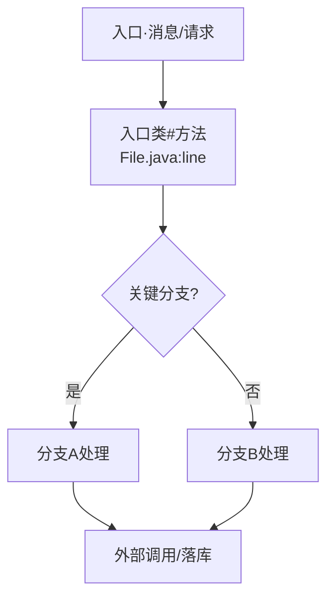
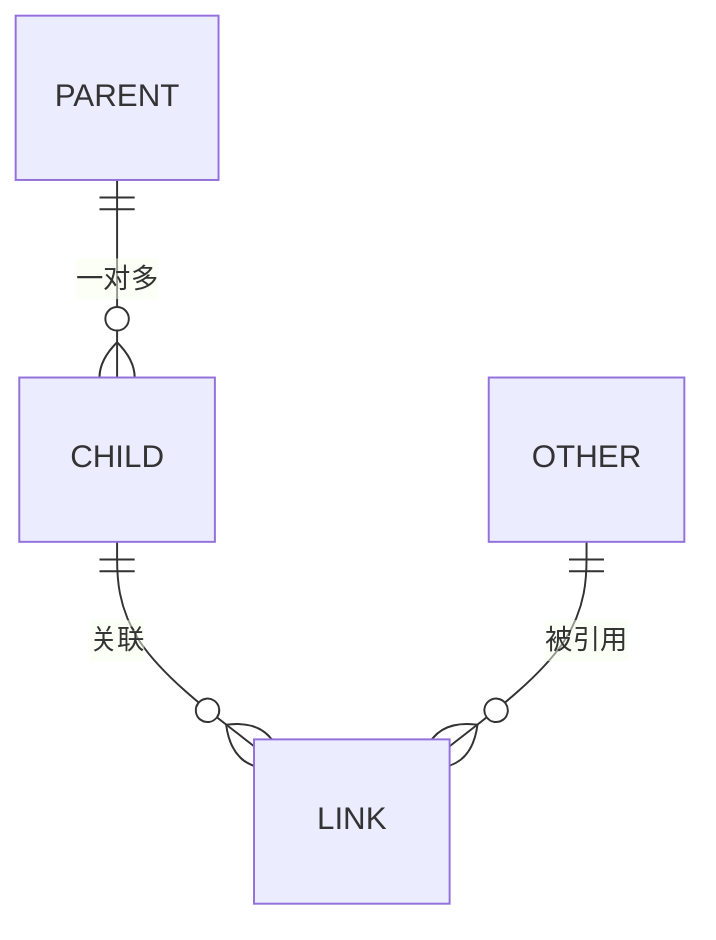
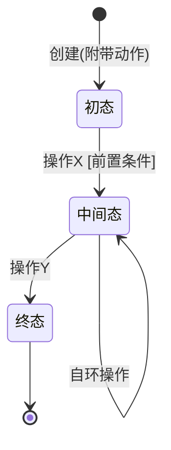

# 12 段讲解模板（详解 + mermaid 骨架）

合成阶段照此填充。每段给"放什么 / 怎么做 / 骨架"。`file:line` 贯穿全文——业务结论不带定位就是浮于表面。

---

## 1. 一句话定义 + 业务目标

- **定义**：一句话说清这业务是什么、给谁用、解决什么。讲人话，不堆术语。
- **业务目标**：3-6 条，产品视角的"为什么做"。来自 PRD/commit/ticket，推断的标「推断」。
- **演进一句话**：什么时候起、关键里程碑、主 commit/ticket 号。

## 2. 术语表

中文业务词 ↔ 代码标识 ↔ 含义。这是消除"同一概念多种叫法"的锚。

| 中文 | 代码标识 | 含义 |
|---|---|---|
| 触发场景 | `positiveRouterPrompt` | ... |

## 3. 角色 & 场景

- **角色**：谁参与（操作者各类账号 / 终端用户 / 外部系统），各自能干啥、边界。
- **场景**：主场景分阶段（如 配置态 / 运行态），各一句话；附 1-2 个异常场景。

## 4. 端到端流程图

主链路。节点标 `类#方法 file:line`，分支用判定节点。

## 5. 数据模型

实体关系图 + 实体职责表 + 关键枚举。

| 实体 | 职责 | 关键字段(字段→业务含义) |
|---|---|---|
| Xxx | ... | `status`(状态) · `userId`(归属) · `deleted`(逻辑删) |

**关键枚举**：逐个列全值 + 含义，状态类枚举单独强调（喂给状态机段）。

> 表名是 `@Table` 注解读出还是推断？标清楚。

## 6. 状态机

只要业务有状态字段就画。标清每个流转的**前置条件/闸门**。

附关键闸门说明：如"未发布不能启用（`Bo:line`，报错文案）"。

## 7. 核心业务规则

业务的"深"集中在这。覆盖：配额/上限、字段校验、归属/权限、默认值、版本规则、并发(乐观锁)、级联、通知。

| 规则 | 条件 | 位置 |
|---|---|---|
| 配额上限 N | 创建时 | `Bo:line` · 报错文案 |

## 8. 触发入口

- **配置态**：Controller API 清单（HTTP 方法+路径 | 干啥 | 入参/出参 DTO）。
- **运行态**：消息消费/定时/RPC 入口（类#方法 file:line）。

## 9. 关键代码路径

入口到叶子一行串起，读者可顺着点：

`EntryService:line` → `Filter.doFilter:line` → `Processor.process:line` → `Router.select:line` → `Loader.load:line` → `Client.execute`

## 10. 依赖 & 外部交互

- 外部服务：契约（请求/响应关键字段）、协议、超时。
- 数据源：各变量/字段从哪个 service/库来。
- 扩展点：plugin/SPI 机制（如何加新实现）。
- 异步/线程池/事件：并发模型、解耦点。

## 11. 边界 / 异常 / 反例

| 情况 | 行为 |
|---|---|
| 外部超时 | 状态=TIMEOUT → 降级/转人工 |
| 越权操作 | 拒绝 + 文案 |
| 非法状态流转 | 拒绝 |

## 12. 未解之谜

诚实收尾。三类：
- **代码不可见**：在外部系统/他团队（如算法侧策略）。
- **纯推断**：证据不足的设计意图。
- **需人确认**：可疑/遗留/与文档冲突处。

逐条带：是什么 + 为什么没挖到 + 线索在哪。

---

## 裁剪规则

- 小业务：5/6 的图可省留表；8/9 可合并。
- **1、2、4、7、12 永远保留** —— 定义、术语、主流程、规则、盲区是"不浅"的最低保证。
- 输出是讲解不是代码 dump：综合、对账、去重，不是粘贴探子原文。
