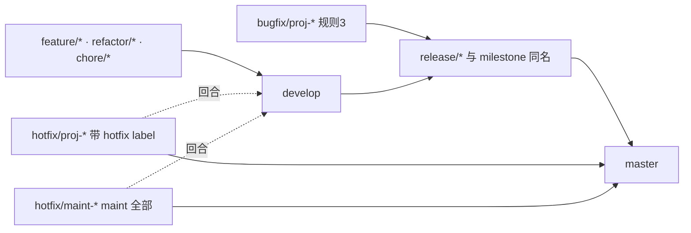

# Git 分支 & Commit 规范（Metis）

本规范适用场景

代码库组：https://git.darcytech.com/repos/jx/aikf

* 代码库组，内部有多个代码仓库

产研issue管理：https://git.darcytech.com/proj/jx/aikf

* 产品PRD需求，研发技术需求

客户问题issue管理：https://git.darcytech.com/maint/jx/aikf

* 客服线上反馈的问题


本规范统一这些 repo 的分支与提交命名，核心是让提交能跨 group 关联到正确的 issue。

适用：在 jx/aikf` 相关代码库里建分支、写 commit、引用 issue。不适用：与 aikf 无关的其它项目。

## 前提（决定后面所有规则的根因）

- **Issue 有两个库**，各自独立的 iid 序列：
  - `proj/jx/aikf` — 产研issue管理 。有 `hotfix` label 与 `type:*` label，有活跃 milestone
  - `maint/jx/aikf` — 线上issue管理 。**修它一律走 `hotfix/` + base `master`**（详见 §1 base 判定）
- **代码库在repos中**。因此 commit 里引用 issue **必须带完整路径**（`proj/jx/aikf#123`），裸 `#123` 跨 group 无法识别、关联不到。
- **Issue 关闭由审核人手动做**，GitLab 运维已禁用自动关闭。提交里的引用只用于建立关联链接，不负责关状态。

## 1. 分支命名

格式：

```
<type>/<source>-<iid>-<slug>
```

| 段        | 取值                                                       | 说明                                                   |
| -------- | -------------------------------------------------------- | ---------------------------------------------------- |
| `type`   | `feature` `bugfix` `hotfix` `refactor` `chore` `release` | 工作类型，决定生命周期与合并流向                                     |
| `source` | `proj`（项目 issue）· `maint`（线上反馈）                          | issue 来源，取值与 issue 库路径同名                             |
| `iid`    | 纯数字                                                      | issue 号。**不带 `#`** —— `#` 在分支名 / URL / refspec 里会出问题 |
| `slug`   | kebab 短描述（中文可）                                           | 去空格与特殊字符，用 `-` 连接                                    |

### base 怎么定（按序短路，命中即停）

| #   | 条件                                                        | 分支前缀      | base          | 合并目标                     |
| --- | --------------------------------------------------------- | --------- | ------------- | ------------------------ |
| 1   | issue 在 **`maint` 库**                                     | `hotfix/` | `master`      | `master` **+** `develop` |
| 2   | `proj` 库 + 带 `hotfix` label                               | `hotfix/` | `master`      | `master` **+** `develop` |
| 3   | `proj` 库 + `type:Bug` + **与 milestone 同名的 release 分支已存在** | `bugfix/` | 该 `release/*` | 该 `release/*`            |
| 4   | 其余                                                        | 见下方类型表    | `develop`     | `develop`                |

判定要点：

- **`maint` 库恒等于 hotfix**。该库就是线上问题反馈，库本身即紧急语义，不看 label —— maint 库也确实**没有** `hotfix` label（它用 `S0`–`S4` / `立即排查` / `24小时排查` 表达紧急度，这些**不参与** base 判定）。所以**不存在 `bugfix/maint-*`**。
- **`hotfix` label 只有 `proj` 库有**，且与 `type:*` **正交**：`type:功能` / `type:改进` / `type:技术任务` / `type:Bug` 都可能带 `hotfix`。所以规则 2 必须排在规则 3 前面 —— 带 `hotfix` 的 `type:Bug` 走 `master`，**不**走 release。
- **milestone title 就是分支名全称**（`release/20260715`），与 release 分支**字面同名**，不做任何格式转换、不自己拼日期。带 `hotfix` label 的 issue，milestone 一般直接标 `master`，天然不会误命中规则 3。
- **规则 3 的「分支已存在」是硬条件**。milestone 常先于分支建好（例：milestone `release/20260722` 已 active，但远程还没拉出对应分支），此时落到规则 4 从 `develop` 拉。

检查分支是否存在：

```bash
git fetch --prune
git rev-parse --verify --quiet "origin/<milestone-title>"   # milestone title 已含 release/ 前缀
```

> release 分支名不止日期形式，实际还有 `release/ai_agent_20260109` / `release/dd_20260311` / `release/metis_refactor` 等带业务前缀的。一律以 milestone title 为准。

### 类型表

| 场景                   | 来源      | 分支示例                                        | 命中规则 |
| -------------------- | ------- | ------------------------------------------- | ---- |
| 新需求                  | proj    | `feature/proj-10523-属性应答管理`                 | 4    |
| 迭代内 bug（release 已拉出） | proj    | `bugfix/proj-10524-转人工规则重复未提示`              | 3    |
| 项目 issue 紧急          | proj    | `hotfix/proj-10621-用户过期续费通知算法重新训练`          | 2    |
| 线上反馈（maint 全部）       | maint   | `hotfix/maint-1479-算法日志遗漏客服消息`              | 1    |
| 重构 / 性能              | proj    | `refactor/proj-10509-精简FaqSceneDiffUtils`   | 4    |
| 杂务 / 构建 / 依赖         | proj    | `chore/proj-10500-升级liquibase`              | 4    |
| 无 issue 的杂务          | —       | `chore/升级liquibase`（省略 `<source>-<iid>-` 段） | 4    |
| 回滚                   | 随被回滚的改动 | 与被回滚分支同前缀同 base                             | —    |
| 发版                   | —       | `release/20260622`，与 milestone title 同名     | —    |



分支规则：

- 回主干用 **rebase，不用 merge**（worktree 同理）。
- 已 push 的 commit 不要 rebase 改写。
- `master` / `develop` 受保护，只经 MR 合入。

## 2. Commit 命名

第一行（subject）：

```
<type>: <完整路径>#<iid> <祈使句描述>
```

issue 完整路径放在 type 之后、描述之前，保证机器能跨 group 关联到正确 issue；描述用祈使句、简短、结尾不加句号。

### type 取值

收敛成这 8 种，停用现状里 `feature` / `feat` / `fixes` / `bugfix` 裸词混写：

| type       | 用途           | 配套分支前缀                |
| ---------- | ------------ | --------------------- |
| `feat`     | 新功能          | `feature/`            |
| `fix`      | 修 bug（含线上）   | `bugfix/` · `hotfix/` |
| `refactor` | 重构，不改外部行为    | `refactor/`           |
| `perf`     | 性能优化         | `refactor/`           |
| `docs`     | 文档           | `chore/`              |
| `test`     | 测试           | `chore/`              |
| `chore`    | 构建 / 依赖 / 杂务 | `chore/`              |
| `revert`   | 回滚           | 同被回滚的改动               |

commit type 统一不表达紧急度，不设 `hotfix:` —— 那是分支前缀 `hotfix/` 的维度。注意 `hotfix/` 前缀有两个来源：`maint` 库**全部**（库即语义），以及 `proj` 库带 `hotfix` label 的，两者 commit type 都照实质写（多为 `fix`，但 proj 的 hotfix 也可能是 `feat`——见 §1 正交说明）。

subject 整行控制在 **72 个显示宽度**内（汉字算 2）。`fix: proj/jx/aikf#10524 ` 这段前缀就吃掉 24，留给描述的不多，描述别铺开写，展开放 body。

### body（可选，第二段起）

- 与 subject 间空一行。
- 写 **what + why**，不写 how。
- 改动 **≥30 行或跨 ≥3 文件**时建议补 body 说明动机。
- 每行 ≤ 72 个显示宽度（汉字算 2，即约 36 个汉字）。

## 3. 完整示例

**项目新需求**（规则 4：无 `hotfix` label、非 `type:Bug`）

```
分支: feature/proj-10523-属性应答管理   base: origin/develop

feat: proj/jx/aikf#10523 新增属性应答管理页与配置接口

按 SKU 维度配置自动应答话术，覆盖原全局话术；旧全局配置作为兜底保留。
```

**迭代内 bug**（规则 3：`type:Bug` + milestone `release/20260715`，该分支已存在 → base 它，改完也回它）

```
分支: bugfix/proj-10524-转人工规则重复未提示   base: origin/release/20260715

fix: proj/jx/aikf#10524 自定义转人工规则重复条件保存时补提示
```

**线上反馈**（规则 1：`maint` 库全部走 hotfix，不看 label）

```
分支: hotfix/maint-1479-算法日志遗漏客服消息   base: origin/master

fix: maint/jx/aikf#1479 算法日志原始请求补回历史中的客服消息
```

**项目 issue 紧急修复**（规则 2：`proj` 库带 `hotfix` label，与 `type:*` 无关）

```
分支: hotfix/proj-10621-用户过期续费通知算法重新训练   base: origin/master

fix: proj/jx/aikf#10621 过期续费广播通知算法重训并新增商品增量接口
```

**重构**（规则 4）

```
分支: refactor/proj-10509-精简FaqSceneDiffUtils   base: origin/develop

refactor: proj/jx/aikf#10509 精简 FaqSceneDiffUtils 重复分支逻辑
```

**同一 issue 带 `hotfix` label 但不是 bug**（规则 2 短路掉规则 3/4，commit type 照实质写）

```
分支: hotfix/proj-10609-提升请求Agent的消息量   base: origin/master

feat: proj/jx/aikf#10609 放宽 Agent 请求限流以提升消息量
```

## 4. 红线速查

1. 分支：`<type>/<source>-<iid>-<slug>`，**不带 `#`**，source 取 `proj` / `maint`（由 issue 库定）。
2. **base 按序短路四条**：maint 库 → `hotfix/`+`master`；proj 带 `hotfix` label → `hotfix/`+`master`；proj `type:Bug` 且同名 release 分支**已存在** → `bugfix/`+该 release；其余 → `develop`。**无 `bugfix/maint-*`**；`hotfix` label 与 `type:*` 正交，规则 2 先于规则 3 判。
3. commit 第一行：`<type>: <完整路径>#<iid> <祈使句描述>`。
4. 跨 group → issue 引用**必须带完整路径**（`proj/jx/aikf#N` / `maint/jx/aikf#N`），裸 `#N` 无效。
5. type 收敛 8 种，停用裸词混写。
6. 回主干 **rebase 不 merge**；已 push 的 commit 不改写；已 push 的分支不重命名。
7. issue 关闭归审核人手动，提交引用只建关联。

## 5. 修复模式（给定 issue 链接，对齐已有分支 / commit）

触发：用户给出 GitLab issue 链接，要求把**当前分支**的分支名与 commit message 按本规范修正。
铁律：**只改未推送内容**。已 push 的分支名 / commit 不动（改了会破坏他人历史）。

### Step 0 安全门（先查，再动）

**先 fetch**，否则下面所有 remote-tracking ref 都是陈旧的，安全门会误判「未推送」：

```bash
git fetch --prune                     # 必须，别省
git status -sb                        # 看 ahead/behind、当前分支
git rev-parse --abbrev-ref @{u} 2>/dev/null   # 有无 upstream
git log @{u}..HEAD --oneline          # 有 upstream：这些就是可改的未推送 commit
```

-    **有 upstream** → 分支名已在远程存在。**跳过 Step 2（不重命名）**，只做 Step 3 改未推送的 commit。本地 `git branch -m` 不动远程，硬改只会让本地与 upstream 脱钩、远程留一个旧名孤儿分支。要改名只能由用户自己删远程旧分支重推，别替他决定。
- **无 upstream** → 与 base 比（base 按 Step 1 判定结果，**不是**固定 `origin/develop`）：`git log $(git merge-base HEAD "$BASE")..HEAD --oneline`，并向用户确认这就是要修的范围。
- 任一目标 commit 已存在于远程（`git branch -r --contains <sha>` 非空）→ **停手**，告知不可改写已推送历史。
- 当前在 `develop` / `master` / `release/*` 上 → **两步都不做**。这些分支受保护，未推送 commit 也不该在这里 amend。提示用户先 `git switch -c <规范分支名>` 把工作挪走。

### Step 1 解析 issue 链接 → 拿规范要素

任何 GitLab 操作**先调 `glab` skill**（Skill 工具，`skill: "glab"`），照它的命令写法来。

链接形如 `https://git.darcytech.com/<project-path>/-/issues/<iid>`。`glab issue view` **直接吃这个链接**，不用拆 project path、不用 encode：

```bash
glab issue view "<issue 链接>" --output json \
  --jq '{iid, title, labels, milestone: .milestone.title}'
```

一次拿全判定要素。两库实测输出：

```
proj#10621 → {"iid":10621,"labels":[...,"hotfix",...,"type:改进"],"milestone":"master",...}
maint#1491 → {"iid":1491,"labels":["S3",...,"type:Bug","立即排查"],"milestone":null,...}
```

- `source`：链接含 `proj/jx/aikf` → `proj`；含 `maint/jx/aikf` → `maint`。完整路径同名，用于 commit 里的 issue 引用。

- 定 commit `type`：`type:Bug` → `fix`；`type:功能` → `feat`；`type:改进` / `type:技术任务` → 看改动实质（`refactor` / `perf` / `chore`）；maint 库无 `type:功能`，基本恒 `fix`；不明确 → 问用户。

- 定**分支前缀与 base**，照 §1 四条**按序短路**判（那张表是唯一判定源，别另起炉灶）：
  
  ```bash
  # 1) source=maint                                      → hotfix/ + origin/master
  # 2) labels 含 hotfix                                   → hotfix/ + origin/master
  # 3) labels 含 type:Bug 且 milestone 同名分支存在        → bugfix/ + origin/$MS
  # 4) 其余                                               → origin/develop
  MS=$(glab issue view "<issue 链接>" --output json --jq '.milestone.title // empty')
  git rev-parse --verify --quiet "origin/$MS"   # 有输出=分支存在，规则 3 才成立
  ```
  
  milestone 为 `null`（maint 常见）或值是 `master` 时，`origin/$MS` 自然查不到 release 分支，规则 3 不会误命中。
  `$BASE` 取 `origin/master` / `origin/$MS` / `origin/develop` 三者之一，**Step 0 / Step 3 / Step 4 都用它**。

- 链接不属于 `proj/jx/aikf` / `maint/jx/aikf` 两库 → 提示来源不在规范内，问用户如何映射。

### Step 2 重命名分支（**仅当 Step 0 判定无 upstream**）

```bash
git branch -m <type>/<source>-<iid>-<slug>
```

`<type>` 用 Step 1 判出的分支前缀（`hotfix` / `bugfix` / `feature` / …），不是 commit type。
slug 由 issue title 生成：裁 ≤30 字、去特殊字符、空格转 `-`、保留中文。

> 若实际 base 与规范要求的不符（例：判定该从 `origin/master` 拉，分支却是从 `develop` 拉的），**只报告、不自动 rebase 换底**——换底会改写全部 commit 且可能引入冲突，交给用户决定。

### Step 3 规范化 commit message（仅未推送集合）

逐条读旧 message，**剥掉旧前缀**（`feature ` / `bugfix ` / `fix: ` / `fixes ` / 旧 `proj|maint/jx/aikf#NNNN ` 等），保留有意义的描述，重排成：

```
<type>: <完整路径>#<iid> <清洗后描述>
```

per-commit 推断 type（多数同一 issue 同 type；明显是测试/文档/重构的单独给 `test`/`docs`/`refactor`）。描述保持原 commit 语言。

**动手前**：把「旧 → 新」全量对照打印给用户，确认后再改。

执行（本 harness **不支持 `git rebase -i`**，用下列方式）：

- **单条**未推送 commit：
  
  ```bash
  git commit --amend -m "<type>: <完整路径>#<iid> 描述"
  ```
- **多条**：从 base 安全重放，逐条改写，校验无误再移动工作分支：
  
  ```bash
  fork=$(git merge-base HEAD "$BASE")   # $BASE 来自 Step 1 判定；有 upstream 时用 @{u}
  git checkout -b <work>-rewrite "$fork"
  # 按旧→新、从最老到最新逐条：
  git cherry-pick <sha>            # 重放一条
  git commit --amend -m "<新 message>"   # 改写该条
  # …重复直到最后一条…
  git diff --stat <原工作分支> HEAD        # 必须为空：树一致，只改了 message
  git branch -f <原工作分支> HEAD   # 确认无误后把原分支指过来
  git checkout <原工作分支>
  git branch -D <work>-rewrite      # 清理临时分支
  ```
  
  `$BASE` 千万别写死 `origin/develop`：hotfix 分支实际从 `master` 拉，用 develop 算 fork 点会把 master 上、develop 上没有的 commit 全卷进重写范围。
  冲突就停下报告，别强行跳过。

### Step 4 复核

```bash
git status -sb                          # 分支名
git log --oneline "$BASE"..HEAD         # 只该列出本次工作的 commit，多出来的说明 base 判错了
```

逐条核对 message 合规、条数与 Step 3 打印的对照表一致。

提示用户：改的都是未推送 commit，后续正常 `git push -u` 即可，**无需 force**。若 Step 0 判定有 upstream（分支名保持原样未改），告知分支名不合规但已推送，需不需要改名由他定。
